# Offset

Offset programs Baofeng UV-5R family, Baofeng DM-32UV and Radtel RT-950 Pro radios (stock or
nicFW950 firmware) from an Android phone over a USB programming cable.
Read the radio, find repeaters near you or in the state you are heading to, pick the ones you
want, and write them to the radio. Keep a library of full radio images, one per state or trip,
edit any of them, and restore the right one before you leave.

It is a programming tool first. Repeater search exists to fill channels.

- Amateur (2m, 70cm) and GMRS repeaters: near you (a radius or the closest 100), by state and
  county, or by callsign, city or frequency, with a filter to hide mixed-mode repeaters.
- A map of the results or of everything on the phone, with band coloured pins and clustering.
- Reach: a terrain-aware coverage map for your own station on VHF and UHF, showing which
  repeaters and people you can work in each direction, with a terrain profile for any link.
  Modelled on the phone with NTIA's Longley-Rice model; see [docs/REACH.md](docs/REACH.md).
- Simplex presets: national calling, 2m and 70cm simplex, NOAA weather, FRS/GMRS 1 to 22 and GMRS
  repeater pairs.
- No accounts, no analytics, no crash reporting, no Google Play Services. Runs on GrapheneOS.
- Your position never leaves the phone: distance and bearing are computed locally. (The map
  downloads tiles for the area you view from OpenFreeMap; see below.)
- Every write is preceded by a full read and an automatic backup, touches only channel memory,
  and is verified by reading the radio back.
- Free software under GPL-3.0-or-later. The radio protocol is ported from [CHIRP](https://github.com/kk7ds/chirp).

## Screenshots

| Staging on the Radio tab | Radio type | Repeaters near you | Repeater map |
| :---: | :---: | :---: | :---: |
| 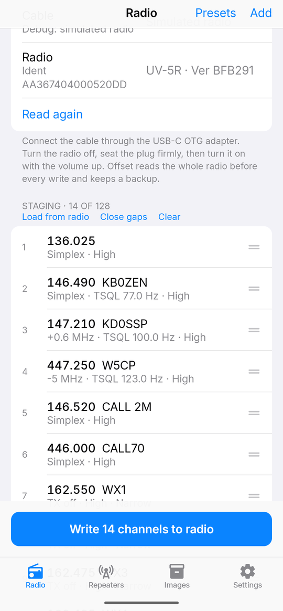 | 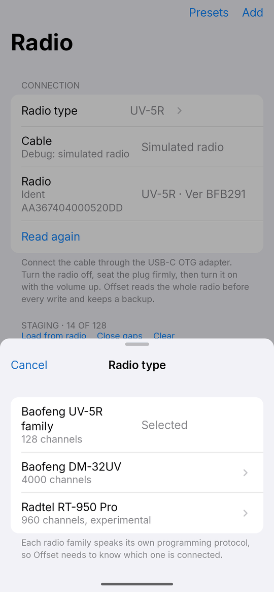 | 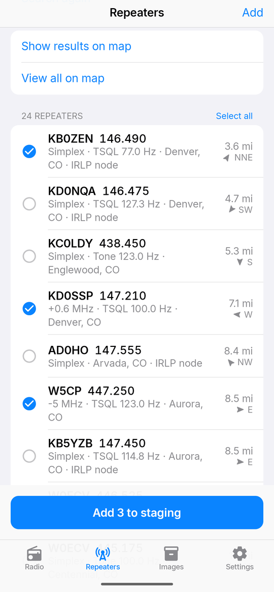 | 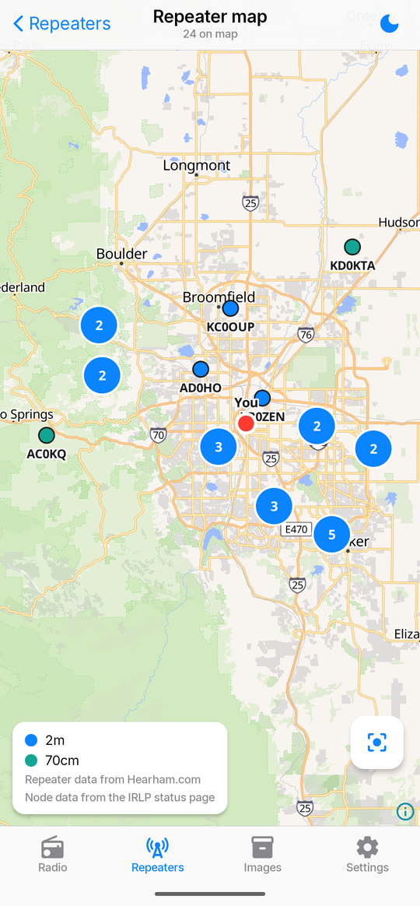 |
| **Confirm the write** | **Write and verify** | **Written and verified** | **Image library** |
| 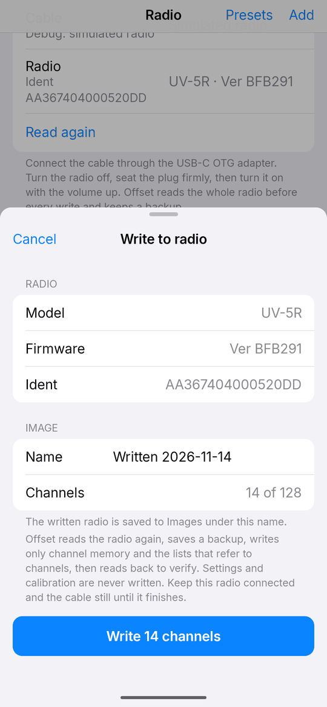 | 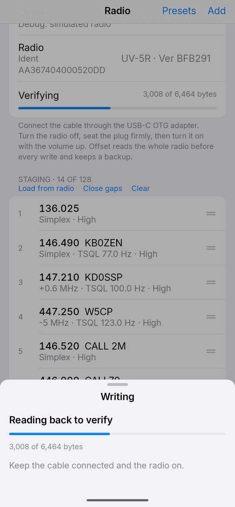 | 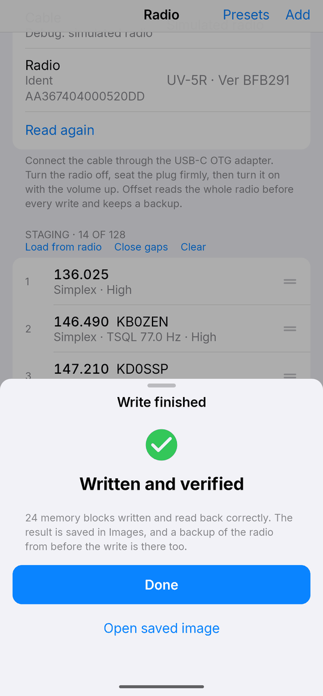 | 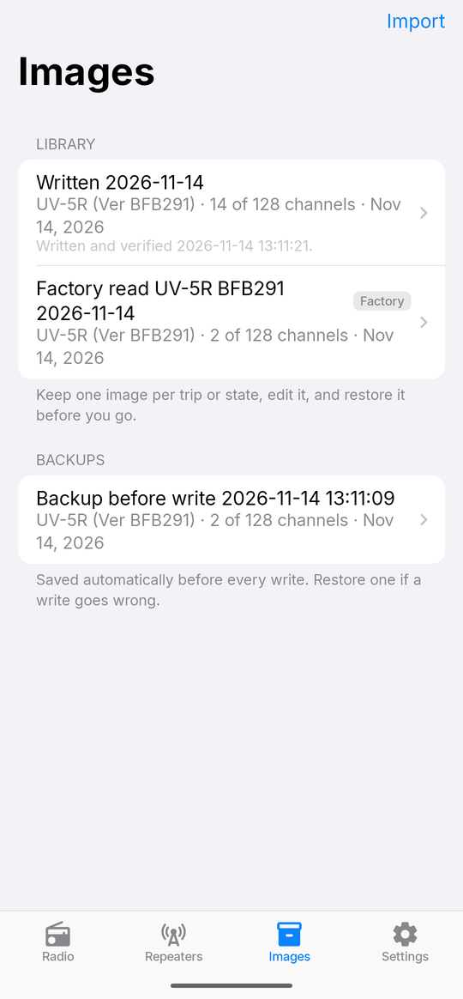 |
| **Reach: coverage over terrain** | **Reach: one link, both ways** | **Reach: your station** | **Reach: your team** |
| 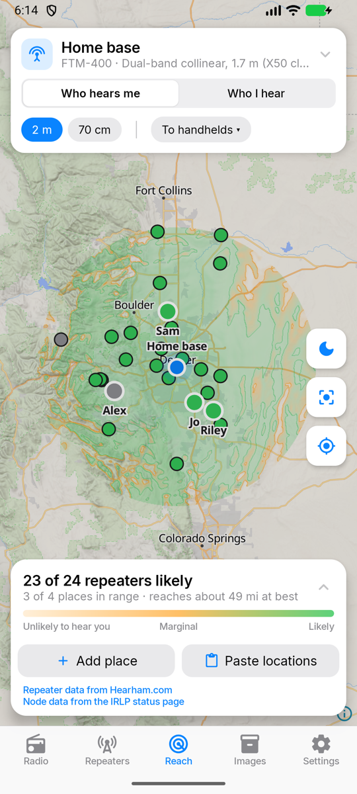 | 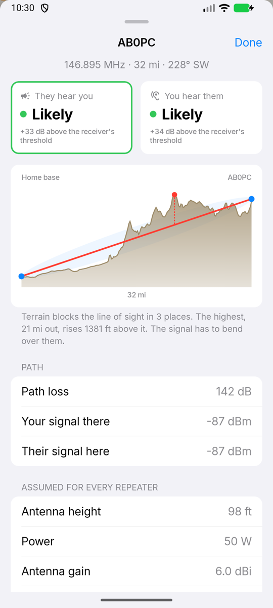 | 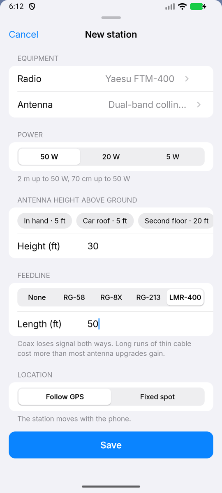 | 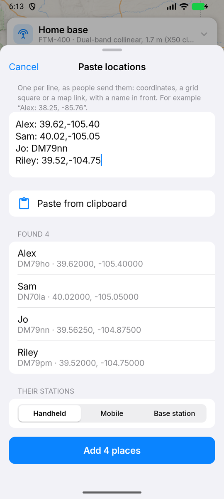 |

Screenshots are from a debug build talking to the simulated radio (see Building). The Reach
screenshots use a simulated position in Denver and repeater data from Hearham.com.

## Supported radios

| Profile | Radios | Power levels |
| --- | --- | --- |
| UV-5R | Baofeng UV-5R (all firmware CHIRP's UV-5R driver accepts, including original firmware before BFB291), UV-5X, Retevis RT5R, RT5RV, RT5, Rugged RH5R, Radioddity UV-5R EX, Ansoko A-5R | High, Low |
| BF-F8HP | Baofeng BF-F8HP, UV-5R 8W, UV-5RTP, Retevis RT5 tri-power, GA-5S, UV-5XP, TI-F8+, UV-5R Pro, TS-T9+ | High, Med, Low |
| DM-32UV | Baofeng DM-32UV (4000 channels) | High, Med, Low |
| RT-950 Pro (experimental) | Radtel RT-950 Pro (960 channels) | High, Med, Low |
| RT-950 Pro nicFW950 (experimental) | Radtel RT-950 Pro running nicFW950 (999 channels) | High, Med, Low |

Pick the radio type on the Radio tab before reading; each family has its own protocol. Within the
UV-5R family the model is detected from the firmware string.

- **DM-32UV.** Ported from CHIRP's driver, which was verified on a radio, and cross checked byte
  for byte against CHIRP. Offset programs analog channels. DMR channels are shown and kept exactly
  as they are, never edited. Channels keep their numbers because the radio's zones and scan lists
  refer to them; new channels go into free numbers and a zone named "Offset" so they can be
  selected on the radio. A cable with an FTDI or CP2102 chip is recommended; some CH340 cables
  corrupt data from this radio.
- **RT-950 Pro (experimental).** CHIRP has no driver. The protocol and channel layout come from
  community reverse engineering (credited below) that was tested on a radio, but Offset itself has
  not written to one yet. Only channel memory is written; settings, VFOs and APRS are never sent.
  AM, frequency hopping and scrambler settings are kept as stored. The radio reportedly programs
  through a CH340 cable; which plug it uses is not confirmed.
  Offset's driver matches the CHIRP module (Nathan Barguss's) that has been shown reading and
  writing the radio, byte for byte; Offset writes less (channels only).
- **RT-950 Pro on nicFW950 (experimental).** For radios flashed with nicsure's nicFW950. nicFW
  speaks its own protocol and stores 999 channels in its own format, so choose this type rather
  than "RT-950 Pro". Built from nicsure's published documentation and checked against his
  programming app; not yet run on a radio by Offset. Only channel records are written, and only
  the blocks that change; VFOs, settings, groups' names, band plan and calibration are never
  read or written. Groups, clarifier, scrambler and nicFW's extra power levels are kept as
  stored. nicFW restarts the radio after a write. Offset does not flash firmware.

Bluetooth radios (UV-Pro, VR-N76) and programming digital channels are out of scope.

## Supported cables

You need a USB-C OTG adapter (USB-C plug to USB-A socket) and a Kenwood 2-pin programming cable
with one of these USB serial chips:

| Chip | USB vendor id |
| --- | --- |
| FTDI FT232 family | `0403` |
| Prolific PL2303 | `067B` |
| WCH CH340 / CH341 | `1A86` |
| Silicon Labs CP210x | `10C4` |

Seat the 2-pin plug firmly (most "radio did not answer" errors are a half inserted plug), turn
the radio off and on again with the volume up, and keep it on a quiet channel while programming.
Android asks once for permission to use the cable.

## Install

Download `offset-<version>.apk` and `SHA256SUMS` from
[GitHub Releases](https://github.com/vyntric-hq/offset/releases), verify them (below), and
install. Offset is not on the Play Store. It is built to F-Droid's inclusion rules (FOSS
dependencies only, reproducible builds).

## Verify the APK you downloaded

Do all three. Replace `1.2.3` with the version you downloaded.

**1. Build provenance.** The release workflow attests every APK with GitHub's artifact
attestations. With the [GitHub CLI](https://cli.github.com):

```sh
gh attestation verify offset-1.2.3.apk --owner vyntric-hq
```

**2. Signing certificate.** With `apksigner` from the Android SDK build tools:

```sh
apksigner verify --print-certs offset-1.2.3.apk
```

The `Signer #1 certificate SHA-256 digest` must equal the release key fingerprint:

```
Release certificate SHA-256 (keytool form):
E0:39:A2:72:7A:EB:35:89:A4:78:04:0B:B7:4A:8C:7E:89:98:00:77:E4:EA:FA:2E:0F:A3:2C:8C:A8:12:1C:62
apksigner prints the same value as:
e039a2727aeb3589a478040bb74a8c7e89980077e4eafa2e0fa32c8ca8121c62
```

The installed app shows its own certificate fingerprint under Settings, About, and says whether
it matches the published one.

**3. Checksum.**

```sh
sha256sum --check SHA256SUMS
```

You can also rebuild the APK yourself and compare it, see [docs/REPRODUCIBLE.md](docs/REPRODUCIBLE.md).

## Using Offset

1. **Radio tab.** Choose the radio type, connect the cable and tap Read radio. The first read of a radio is saved to
   Images as "Factory read ...". Its channels fill the staging list if staging is empty.
2. **Repeaters tab.** Search near your GPS position, a Maidenhead grid square (EM78gh), typed
   coordinates or a county (the closest 100, or 10, 25, 50 or 100 miles; GPS can track you live), by state and county, or by text. Filter by service (amateur, GMRS, both), ham band and
   mixed mode. "Show results on map" and "View all on map" put the repeaters on a map; tap a pin
   for details. Select repeaters and tap Add to staging. Add simplex or unlisted channels with Add.
   On the Radio tab, Presets adds common simplex, weather and FRS/GMRS channel sets.
3. **Radio tab.** Staged channels show the radio's own channel numbers; reading a radio keeps
   every channel where it is. Reorder (drag the handle), remove (swipe left) or edit (tap) them,
   then Write. Offset shows the radio, image name and channel count to confirm, then reads the
   radio again, saves a backup, writes, reads back and verifies. The result is saved in Images.
4. **Images tab.** Edit any saved image's channels, duplicate, rename, export or import CHIRP
   `.img` and CSV files, or Restore to radio.

**GMRS.** GMRS channels are programmed with transmit enabled, after a one time warning: in the
US, transmitting on GMRS needs an FCC GMRS license and a Part 95 certified radio, and UV-5R family
radios are not Part 95 certified. You are responsible for operating legally.

Repeater data is community maintained and can be wrong. Check frequencies and tones before you
rely on them, and never rely on this app or its data in an emergency.

## Repeater data sources

Choose under Settings, Repeater data source. Details, caching and policies are in
[docs/DATA_SOURCES.md](docs/DATA_SOURCES.md).

- **Hearham** (default). Free, no account. A snapshot of about 12,500 repeaters is included with
  the app, so searching and the map work offline from the first launch. When the phone is online
  and the data is more than a week old, Offset refreshes it quietly; Refresh fetches on demand.
  Repeater data from [Hearham.com](https://hearham.com). IRLP node listings and OpenStreetMap
  repeater listings are bundled too and merged in (see below).
- **RepeaterBook** (optional). Uses your own token. RepeaterBook accounts need an amateur or
  US GMRS callsign; Offset cannot change that. 1. [Create an
  account](https://www.repeaterbook.com/index.php/component/users/?view=registration). 2. Open the
  [token page](https://www.repeaterbook.com/user/api_apps.php) and sign in (the sign-in page is
  RepeaterBook's own, called Vista). 3. Pick Offset, generate a token and copy it; it is shown
  once. 4. Paste it with your contact email under Settings, RepeaterBook, and tap Test
  connection. Offset is listed there only after RepeaterBook approves it; see
  [RepeaterBook's API page](https://www.repeaterbook.com/wiki/doku.php?id=api). The
  token is stored encrypted and sent only to repeaterbook.com. Results are cached for 24 hours
  per state. Data courtesy of [RepeaterBook.com](https://www.repeaterbook.com). RepeaterBook
  approval applies to this app only; forks must apply separately.
- **CHIRP CSV**. Import a coordinator list or your own list from the file picker (Repeaters,
  Import). Add Latitude and Longitude columns to enable distance search.

**Verification.** Each repeater shows which directories list it. "2 sources" in a result row
means two independent directories (Hearham, IRLP, OpenStreetMap) agree on the frequency and
site (an entry one directory copied from another does not count); "IRLP node" means the
repeater is an IRLP node and the sheet shows when it last reported in; "Sources disagree on
tone" means they list different access tones. The detail sheet's
"Listed by" section names each directory and, for IRLP nodes, when the node last reported to the
IRLP network. This is evidence, not a guarantee: check on the air.

The bundled data is limited to directories that allow redistribution. RepeaterBook, the ARRL
directory, RFinder and myGMRS do not, and Offset does not scrape them.

GMRS repeaters come from RepeaterBook (with your token) or an imported CSV; Hearham lists only a
handful, and RepeaterBook data is never bundled (its policy forbids offline bundling). Downloaded
data keeps working offline; the "updated" date shows how old it is.

**Map.** The map uses [MapLibre](https://maplibre.org) with free vector tiles from
[OpenFreeMap](https://openfreemap.org) (map data © OpenStreetMap contributors, © OpenMapTiles). It
needs a connection for areas you have not viewed before, and the tile server sees which area you
view. No account or key is involved.

## Safety

Offset follows seven rules on every write: full read first; never write to a radio whose ident
differs from the image's; only channel and name memory is written (never settings or
calibration); a timestamped backup is saved first; the radio is read back and compared; a
confirmation sheet names the radio, image and channel count; and a pulled cable, timeout or
denied permission is reported with whether the radio may be partly written and where the backup
is. See [docs/PROTOCOL.md](docs/PROTOCOL.md).

## Building

```sh
./gradlew test assembleDebug          # JDK 17 and the Android SDK (platform 36, build tools 35.0.0)
```

In debug builds, Settings, Debug, Simulated radio replaces the cable with an in-memory radio of
the selected type (UV-5R, DM-32UV, RT-950 Pro or nicFW950) that speaks the same clone protocol, so the whole
app works without hardware. See
[CONTRIBUTING.md](CONTRIBUTING.md).

## Documentation

- [docs/PROTOCOL.md](docs/PROTOCOL.md): each radio family's clone protocol, memory map and record layout as implemented
- [docs/DATA_SOURCES.md](docs/DATA_SOURCES.md): each repeater source and the terrain tiles, their caching and attribution
- [docs/REACH.md](docs/REACH.md): how Reach models coverage, and what it assumes
- [docs/REPRODUCIBLE.md](docs/REPRODUCIBLE.md): rebuilding and comparing releases, signing key setup
- [docs/ASSUMPTIONS.md](docs/ASSUMPTIONS.md): decisions made and what needs a radio to confirm
- [CHANGELOG.md](CHANGELOG.md), [CONTRIBUTING.md](CONTRIBUTING.md), [NOTICE](NOTICE)

## Attribution

- [CHIRP](https://github.com/kk7ds/chirp) (GPL): the UV-5R protocol, memory map and file formats.
- [baoclone](https://github.com/sergev/baoclone) by Serge Vakulenko (BSD): protocol cross check and test images.
- CHIRP's [DM-32UV driver](https://github.com/kk7ds/chirp/blob/master/chirp/drivers/baofeng_dm32uv.py) (GPL): the DM-32UV protocol, layout and zone handling.
- [Radtel-RT950-Pro-Firmware](https://github.com/Hertzz58/Radtel-RT950-Pro-Firmware) (GPL-3.0): the RT-950 Pro clone protocol.
- [Chirp_Radtel-RT-950-Pro](https://github.com/NathanBarguss/Chirp_Radtel-RT-950-Pro) by Nathan Barguss, 2E0NBS (MIT): the RT-950 Pro channel layout.
- nicsure's [nicFW880/950 documentation](https://github.com/nicsure/nicFW880_950_Docs) and [RT950Pro BTLE bridge](https://github.com/nicsure/RT950Pro-BTLE-TCP-Bridge): the nicFW950 protocol and channel layout (facts only; no code copied).
- [Hearham](https://hearham.com): repeater data from Hearham.com.
- [IRLP](https://status.irlp.net): node data from the IRLP status page.
- [OpenStreetMap](https://www.openstreetmap.org/copyright): repeater listings © OpenStreetMap contributors, ODbL 1.0.
- [RepeaterBook](https://www.repeaterbook.com): data courtesy of RepeaterBook.com.
- [NTIA Irregular Terrain Model](https://github.com/NTIA/itm) (public domain, U.S. Government work): the Longley-Rice model behind Reach.
- [AWS Terrain Tiles](https://registry.opendata.aws/terrain-tiles/): elevation from USGS 3DEP, SRTM and GMTED2010 courtesy of the U.S. Geological Survey, Canada under the Open Government Licence, and Mexico from INEGI.
- [MapLibre Native](https://github.com/maplibre/maplibre-native) (BSD-2-Clause) and [OpenFreeMap](https://openfreemap.org) tiles: © OpenStreetMap contributors, © OpenMapTiles.
- [usb-serial-for-android](https://github.com/mik3y/usb-serial-for-android) (MIT), [Inter](https://rsms.me/inter/) (OFL), AndroidX, OkHttp and kotlinx (Apache 2.0).

## License

Offset is free software: you can redistribute it and/or modify it under the terms of the GNU
General Public License as published by the Free Software Foundation, either version 3 of the
License, or (at your option) any later version. See [LICENSE](LICENSE) and [NOTICE](NOTICE).

Baofeng and Radtel are trademarks of their owners. Offset is not affiliated with Baofeng, Radtel, CHIRP, Hearham,
RepeaterBook, MapLibre or OpenFreeMap.
